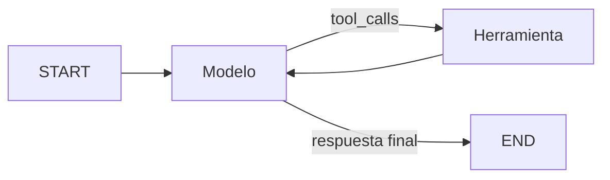

# Agente de diagnóstico con memoria persistente

Agente ReAct asíncrono para investigar incidentes técnicos. El modelo decide cuándo consultar una
herramienta, procesa cada resultado y puede repetir la búsqueda antes de producir una conclusión.
El historial se conserva en SQLite mediante un `thread_id`.

## Arquitectura



El estado `AgentState` hereda de `MessagesState`. El nodo `model` usa un LLM vinculado mediante
`bind_tools()`, `tools_condition` decide si continúa hacia `ToolNode` y la arista de retorno permite
varias iteraciones. La ejecución se limita a diez pasos para impedir ciclos ilimitados.

## Capacidades

- Selección autónoma de herramientas basada en el mensaje del usuario.
- Herramienta propia `search_technical_knowledge` con esquema Pydantic y docstring descriptivo.
- Una consulta independiente por componente técnico.
- Corrección y nuevo intento cuando una búsqueda resulta insuficiente o falla.
- Persistencia asíncrona con `AsyncSqliteSaver` sobre SQLite.
- Continuidad de conversación por `thread_id`.
- Traza JSON con nodos, mensajes, llamadas, resultados y respuesta final.

## Instalación

Requiere Python 3.12 o superior.

```bash
python -m venv .venv
.venv\Scripts\activate
python -m pip install -e ".[dev]"
copy .env.example .env
```

Configurar la credencial en `.env`:

```dotenv
OPENAI_API_KEY=...
OPENAI_MODEL=gpt-5.4-mini
```

`.env`, la base SQLite y sus archivos auxiliares están excluidos del repositorio.

## Uso

Ejecutar una investigación:

```bash
incident-agent ask "Investiga el riesgo de memoria de Redis" --thread-id incidente-42
```

Continuar la misma conversación:

```bash
incident-agent ask "¿Qué umbral crítico mencionaste?" --thread-id incidente-42
```

El segundo comando recupera los mensajes guardados para `incidente-42`.

Ejecutar el escenario multi-paso y guardar la traza:

```bash
incident-agent demo --thread-id demo-multistep --trace artifacts/example_trace.json
```

La consulta de demostración requiere investigar Redis y la API de pagos por separado. La traza
incluida en [artifacts/example_trace.json](artifacts/example_trace.json) permite verificar las
transiciones `model → tools → model`, el número de invocaciones y la respuesta resultante.

## Persistencia

Los checkpoints se guardan por defecto en `state/agent_checkpoints.sqlite`. LangGraph identifica
cada conversación con esta configuración:

```python
config = {
    "configurable": {"thread_id": "incidente-42"},
    "recursion_limit": 10,
}
```

El archivo `.env.example` activa `LANGGRAPH_STRICT_MSGPACK=true` para restringir la deserialización
de checkpoints.

## Estructura

```text
src/incident_agent/
  graph.py       StateGraph, MessagesState, ToolNode y tools_condition
  tools.py       herramienta de consulta técnica
  runner.py      ejecución asíncrona y SqliteSaver
  trace.py       contratos y serialización de trazas
  config.py      variables de entorno validadas
  cli.py         comandos ask y demo
artifacts/
  example_trace.json
tests/
```

## Calidad

```bash
pytest
ruff check .
```

Las pruebas cubren decisiones de herramienta, dos ciclos de consulta, manejo de resultados
insuficientes, aislamiento por `thread_id`, continuidad de memoria y escritura de la traza.
