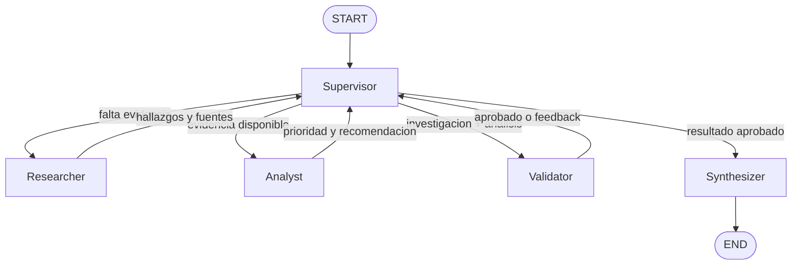

# Orquestador multi-agente especializado

Prototipo de analisis de incidentes que separa investigacion, computo, validacion y sintesis. Un
supervisor jerarquico decide que especialista debe intervenir en cada paso y solo habilita la
respuesta final cuando la evidencia y el analisis superan el control de suficiencia.

## Capacidades

- Supervisor con decisiones estructuradas y rutas condicionales de LangGraph.
- Investigador con una herramienta exclusiva de busqueda documental simulada.
- Analista con una herramienta exclusiva para calcular prioridad P1-P4.
- Estado compartido tipado que conserva aportes, fuentes, decisiones y resultado de validacion.
- Contexto acotado por rol: cada especialista recibe su instruccion y los datos imprescindibles.
- Validador determinista para detectar falta de fuentes, citas inexistentes o calculos invalidos.
- Limite de decisiones del supervisor para evitar ciclos infinitos.

## Topologia



La topologia jerarquica concentra las decisiones de flujo en un solo nodo y mantiene separadas las
responsabilidades. El investigador no calcula severidad; el analista no busca documentos; el
validador no genera evidencia. La sintesis consume un resultado ya verificado.

## Estado compartido

`OrchestratorState` hereda de `MessagesState` e incorpora:

| Campo | Funcion |
| --- | --- |
| `next_agent` | Ruta seleccionada por el supervisor. |
| `supervisor_instruction` | Tarea puntual para el siguiente nodo. |
| `research_findings` | Evidencia estructurada con identificadores de fuente. |
| `analysis_result` | Prioridad, puntaje, factores, recomendacion y fuentes usadas. |
| `contributions` | Registro acumulativo de aportes por agente. |
| `validation_feedback` | Errores que requieren una nueva delegacion. |
| `task_completed` | Condicion obligatoria para entrar a la sintesis. |
| `supervisor_steps` | Contador que limita el ciclo de supervision. |

Las listas `contributions` y `completed_agents` usan reducers aditivos. Los resultados de dominio se
mantienen como datos estructurados, no como historial conversacional formateado.

## Manejo de conflictos

El validador compara las fuentes citadas por el analista con las fuentes recuperadas, exige al menos
dos evidencias y verifica el rango del puntaje. Si encuentra una inconsistencia, escribe feedback en
el estado y el supervisor devuelve la tarea al investigador o al analista. Las guardas del supervisor
impiden sintetizar si faltan prerrequisitos, incluso cuando el modelo propone una ruta incorrecta.

## Estructura

```text
.
|-- agents/
|   |-- research_agent.py
|   `-- analysis_agent.py
|-- artifacts/
|   `-- delegation_trace.json
|-- docs/
|   `-- architecture.md
|-- src/multi_agent_orchestrator/
|   |-- agents/
|   |-- graph.py
|   |-- state.py
|   |-- supervisor.py
|   |-- synthesis.py
|   |-- tools.py
|   `-- validation.py
|-- tests/
|-- demo.ipynb
|-- main.py
`-- pyproject.toml
```

Los archivos de `agents/` en la raiz facilitan la inspeccion directa del entregable; la implementacion
instalable vive en `src/multi_agent_orchestrator/agents/`.

## Instalacion

Requiere Python 3.12 o superior.

```bash
python -m venv .venv
# Windows
.venv\Scripts\activate
python -m pip install -e ".[dev]"
copy .env.example .env
```

Completar `OPENAI_API_KEY` en `.env`. La clave no debe incorporarse al repositorio.

## Ejecucion

```bash
python main.py --trace
```

Consulta personalizada:

```bash
python main.py "Investiga el impacto de errores de checkout y determina su prioridad" --trace
```

La traza esperada contiene esta secuencia:

```text
supervisor -> researcher -> supervisor -> analyst -> supervisor
-> validator -> supervisor -> synthesizer
```

El notebook [`demo.ipynb`](demo.ipynb) ejecuta el mismo recorrido y presenta la decision de cada
paso, las fuentes, el calculo, el control de suficiencia y la respuesta final. Una corrida reproducible
tambien queda registrada en [`artifacts/delegation_trace.json`](artifacts/delegation_trace.json).

## Pruebas

```bash
pytest
ruff check .
```

Las pruebas usan un modelo programado sin llamadas externas y verifican herramientas, rutas,
validacion, secuencia completa y limite de supervision.

## Alcance

El prototipo se ejecuta como aplicacion local de consola. No incluye servidor HTTP, cola de trabajos,
Redis, checkpoints distribuidos, telemetria de produccion ni pausas de aprobacion humana.
